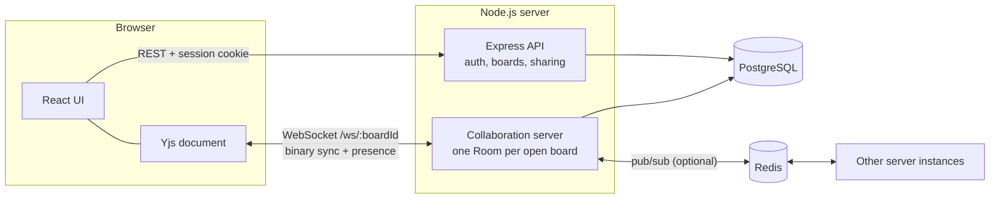

# Real-time collaborative workspace

A collaborative whiteboard in the spirit of Miro. Several people work on the same infinite canvas at once: sticky notes, shapes, text, arrows and freehand drawing, with live cursors and per-user undo. Boards are stored in PostgreSQL, and sharing works through invite links with edit or view-only permission.

I kept the feature set small on purpose and put the effort into the parts that are hard to get right: conflict-free syncing, persistence that survives restarts, server-side permissions, and the ability to run more than one server instance.

**Live demo:** [https://realtime-workspace-2eze.onrender.com](https://realtime-workspace-2eze.onrender.com)

## Contents

- [Features](#features)
- [Tech stack](#tech-stack)
- [Running it](#running-it)
- [How it works](#how-it-works)
- [Data model](#data-model)
- [API](#api)
- [Configuration](#configuration)
- [Deployment](#deployment)
- [Project structure](#project-structure)
- [Trade-offs and known limitations](#trade-offs-and-known-limitations)
- [What I would do next](#what-i-would-do-next)

## Features

**Canvas**
- Infinite canvas with pan and zoom (scroll, Ctrl/Cmd + scroll, Space + drag, trackpad pinch) and fit-to-content
- Sticky notes, rectangles, ellipses, text, arrows, pen
- Move, resize, multi-select (marquee or Shift), duplicate, delete, change colour
- Copy, cut and paste, including between boards. Plain text from the clipboard becomes a sticky note
- Undo and redo that only affect your own changes, never a teammate's

**Collaboration**
- Live cursors, live selection outlines and an online-users indicator
- Edits made while offline merge automatically after reconnecting
- Invite links with `editor` or `viewer` permission, enforced on the server

**Accounts and boards**
- Register and log in, dashboard with your boards and boards shared with you
- Rename and delete boards

## Tech stack

| Layer | Technology |
|---|---|
| Frontend | React 18, Vite, plain CSS, React Router |
| Realtime | Yjs (CRDT), WebSockets (`ws`), Yjs sync and awareness protocols |
| Backend | Node.js 22, Express, zod for validation, pino for logging |
| Database | PostgreSQL 16 |
| Cache / pub-sub | Redis 7 (optional, used to run several server instances) |
| Auth | bcrypt, JWT in an httpOnly cookie |
| Tooling | Docker, Docker Compose, GitHub Actions, `node:test` |

Everything is JavaScript with ES modules. There is no UI component library and no canvas library. Panning and zooming is a single CSS transform, and shapes are ordinary DOM and SVG elements.

## Running it

### With Docker (simplest)

```bash
docker compose up --build
```

Open http://localhost:3000, register two accounts in two browsers, create a board, press **Share** and open the link in the second browser.

In this mode the database and Redis are not exposed on the host, so they cannot clash with anything already running on your machine.

### Local development with hot reload

Requires Node.js 20 or newer and Docker (only for the databases).

```bash
cp .env.example .env
npm install          # root tooling (concurrently)
npm run setup        # installs server/ and client/
npm run db:up        # PostgreSQL on :5432 and Redis on :6379
npm run dev          # API on :3000, Vite dev server on http://localhost:5173
```

Migrations run automatically when the server starts.

### Tests

```bash
npm test
```

- `server/test/room.test.js` runs the collaboration core through the real Yjs sync protocol, without sockets. It checks that edits reach other editors, that late joiners get the full state, that a viewer's writes are rejected, that presence is cleaned up on disconnect, and that a board survives a restart including log compaction.
- `server/test/rate-limit.test.js` covers the rate limiter.
- `client/test/geometry.test.js` covers the canvas maths: bounds, resizing, fit-to-content and path generation.

CI (`.github/workflows/ci.yml`) installs both packages, runs the tests, builds the client and builds the Docker image.

### Trying two server instances locally

```bash
npm run db:up
npm run build
PORT=3000 npm start          # terminal 1
PORT=3001 npm start          # terminal 2
```

Make sure `.env` contains `REDIS_URL`. Open `localhost:3000` in one browser and `localhost:3001` in another and edit the same board. Cookies are shared across ports on `localhost`, so one login works for both.

## How it works



### Syncing with a CRDT

The hard part of a whiteboard is not drawing, it is many people changing the same thing at once, sometimes offline. I used Yjs, a CRDT library, so that every client ends up with the same state without a central lock and without conflict dialogs. The server only relays updates and stores them.

Each element on the board is a `Y.Map` inside one top-level `Y.Map`. Because the properties are separate keys, one person moving a note while another recolours it are both applied. The one exception is text: the content of a note is a plain string, so if two people type into the same note at the same moment, the last write wins.

The client uses the standard `y-websocket` provider. The server side is my own implementation of the same protocol (`server/src/collab/room.js`), because I needed to hook authentication, permissions, persistence and Redis into it.

### Persistence

Implemented in `server/src/collab/pg-store.js` and `persistor.js`.

Each board has an append-only log of Yjs updates (`board_updates`) and one snapshot (`board_snapshots`). Dragging a shape produces dozens of updates per second, so the server batches them for 500 ms, merges them with `Y.mergeUpdates` and writes a single row. Every 200 writes, and when a room closes, the log is folded into the snapshot.

Two details I care about:

- Compaction rebuilds the state from the database, not from the memory of whichever process triggers it. It takes a per-board advisory lock and deletes exactly the rows it folded in. That keeps it correct when several instances are running.
- Loading a board reads the snapshot and the log inside a single `REPEATABLE READ` transaction, so a compaction running on another instance cannot produce a half-old, half-new view.

If a write fails, the batch stays in memory and is retried. On shutdown every open board is flushed before the process exits.

### Permissions

Authorisation happens before a socket exists. The WebSocket handshake checks the `Origin` header, the session cookie and the user's role on the board, and answers 401 or 403 otherwise.

Read-only is enforced on the server as well, not only by hiding the toolbar. A `viewer` connection may ask for the board state, but every message that would change the document is dropped in `Room.receive`, so a modified client cannot bypass it.

### Scaling to several instances

With `REDIS_URL` set, each open board subscribes to a Redis channel. Document updates and presence are published to it and other instances apply them locally. A newly opened room also asks its peers for anything that is not in the database yet.

Delivery through Redis pub/sub is at-most-once. For a CRDT that is acceptable, because a missed update is repaired by the next state exchange. Without Redis everything works on a single instance.

### Frontend notes

- `store.js` bridges Yjs and React. It caches a plain object per element and only replaces the objects of elements that actually changed, so while someone drags a shape the other elements are not re-rendered.
- All mutations go through `ops.js`, and every user action is a single Yjs transaction. This is what makes the undo manager work per user and keeps network messages small.
- Pointer handling in `Canvas.jsx` is a small state machine (pan, move, resize, marquee, draw). Clipboard data is validated before it is inserted into the shared document.

## Data model

```
users            id, email (unique, case-insensitive), name, password_hash
boards           id, owner_id -> users, title, share_token, share_role, updated_at
board_members    (board_id, user_id) -> role: editor | viewer
board_updates    id, board_id -> boards, payload (bytea)      append-only log
board_snapshots  board_id -> boards, state (bytea)            compacted state
```

The schema lives in `server/migrations/`. A small migration runner applies new files in order on startup, inside transactions and behind an advisory lock, so two instances starting together do not race.

## API

| Method | Path | Description |
|---|---|---|
| POST | `/api/auth/register` | Create an account and start a session |
| POST | `/api/auth/login` | Log in |
| POST | `/api/auth/logout` | Log out |
| GET | `/api/auth/me` | Current user |
| GET | `/api/boards` | Boards you own or were invited to |
| POST | `/api/boards` | Create a board |
| GET | `/api/boards/:id` | Board metadata and your role |
| PATCH | `/api/boards/:id` | Rename (owner) |
| DELETE | `/api/boards/:id` | Delete and disconnect everyone (owner) |
| POST | `/api/boards/:id/share` | Create or regenerate an invite link with a role (owner) |
| DELETE | `/api/boards/:id/share` | Disable the invite link (owner) |
| POST | `/api/join/:token` | Join a board through an invite link |
| GET | `/healthz` | Database and Redis status, number of open rooms and connections |
| WS | `/ws/:boardId` | Collaboration channel |

Requests are validated with zod. A board you have no access to answers 404 rather than 403, so ids cannot be probed.

Security measures in place: bcrypt password hashing, a session in an httpOnly, SameSite=Lax cookie (Secure in production), `helmet` headers with a CSP, request size limits, rate limiting on the auth routes (Redis-backed when available), an origin check and a message rate limit on the WebSocket, and a heartbeat that drops dead connections.

## Configuration

Copy `.env.example` to `.env` for local development.

| Variable | Default | Notes |
|---|---|---|
| `DATABASE_URL` | local Postgres | PostgreSQL connection string |
| `DATABASE_SSL` | `false` | Set to `true` if your provider requires TLS |
| `JWT_SECRET` | dev value | **Required in production**, at least 32 random characters (`openssl rand -base64 48`) |
| `REDIS_URL` | not set | Optional, enables multi-instance fan-out and a shared rate limiter |
| `PORT` | `3000` | |
| `NODE_ENV` | `development` | `production` enables secure cookies and enforces `JWT_SECRET` |
| `COOKIE_SECURE` | on in production | Set to `false` only for plain http outside localhost |
| `ALLOWED_ORIGINS` | empty | Extra WebSocket origins, comma separated. Same-origin is always allowed |

## Deployment

The Docker image contains the API, the WebSocket endpoint and the built React app in one process, so any container host works.

**Render.** The repository includes a blueprint (`render.yaml`). Push it to GitHub, choose New, then Blueprint, and select the repository. It creates the PostgreSQL database and the web service and generates `JWT_SECRET`. Render's free database is time-limited, so use a paid plan or an external database for anything permanent.

**Railway, Fly.io or any Docker host.** Create a PostgreSQL database, deploy the repository (it uses the `Dockerfile`) and set `DATABASE_URL`, `JWT_SECRET`, `NODE_ENV=production` and, if needed, `DATABASE_SSL=true`. Add `REDIS_URL` to run more than one instance.

## Project structure

```
server/
  migrations/               SQL schema
  src/index.js              startup and graceful shutdown
  src/app.js                Express app, security headers, static client
  src/routes/               auth and boards REST routes
  src/collab/room.js        Yjs document, awareness, sync protocol, permissions
  src/collab/persistor.js   batching of writes and compaction scheduling
  src/collab/pg-store.js    PostgreSQL log and snapshot storage
  src/collab/pubsub.js      Redis fan-out between instances
  src/collab/ws.js          WebSocket upgrade, authentication, heartbeat
  test/
client/
  src/board/Canvas.jsx      pointer handling, pan and zoom, drawing tools
  src/board/store.js        Yjs to React bridge
  src/board/ops.js          all document mutations
  src/board/Workspace.jsx   toolbar, presence, sharing, shortcuts, clipboard
  src/pages/                login, dashboard, board, invite
  test/
```

## Trade-offs and known limitations

- **Text inside a note is last-write-wins.** Character-level merging would need a `Y.Text` bound to the editor. I chose a plain string to keep the editor simple.
- **Pen strokes reach other users when the stroke is finished**, not point by point. Streaming them live would create a lot of document history for little gain.
- **Permission changes apply on the next connection.** A user who is already connected keeps their role until they reconnect.
- **Sessions are stateless JWTs**, so there is no server-side revocation before they expire (7 days).
- **Presence data is supplied by the client.** Names and cursors shown to other users are not verified by the server.
- **Redis delivery is at-most-once**, as described above.
- **No touch-screen pinch gesture.** Trackpad pinch, Ctrl/Cmd + scroll and the zoom buttons work.
- **No end-to-end browser tests and no load testing.** The collaboration core has automated tests, the UI has only been checked by hand.

## What I would do next

- A Playwright test that opens two browsers and edits the same board
- Character-level merging for text with `Y.Text`
- Board version history built on top of the update log
- Comments and mentions
- Export to PNG or PDF

## License

MIT
